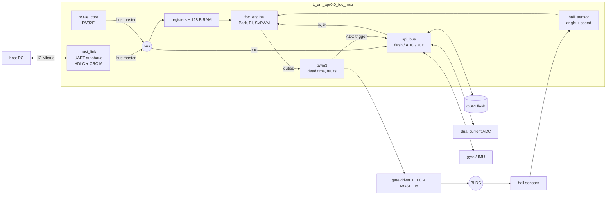
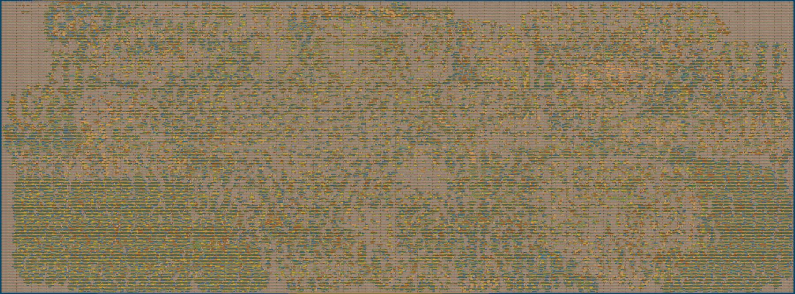
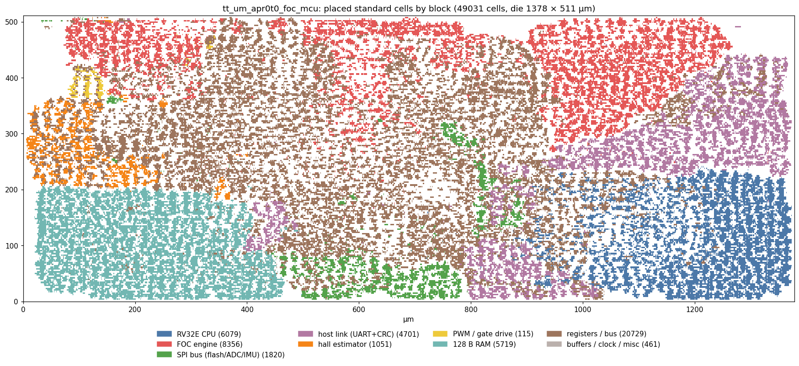

   

# FOC BLDC motor controller + RV32E microcontroller for Tiny Tapeout

`tt_um_apr0t0_foc_mcu` is a Tiny Tapeout (SKY130, 8x4 tiles) chip that runs field-oriented control of a
3-phase BLDC / PMSM motor in hardware. It has a small RISC-V CPU that executes from QSPI flash, and a
CRC-protected 12 Mbaud host link. With an external power stage it drives 24–48 V motors with hall
sensors.

- [Tiny Tapeout datasheet page](docs/info.md)
- [Register map](docs/register_map.md)
- [External hardware / 24–48 V reference design](docs/hardware.md)

## What is on the chip and what is not

| Requirement | Where | How |
|-------------|-------|-----|
| FOC (Clarke / Park / PI / SVPWM) | **on chip** | `foc_engine`: CORDIC + shared multiplier, about 6.6 µs per update at 50 MHz |
| 6 gate-drive channels (logic) | **on chip** | `pwm3`: 6 outputs, dead time, shoot-through interlock, fault shutdown within 5 clocks (100 ns), brake, polarity, bootstrap duty clamp |
| Gate-driver power stage (10–12 V gate drive, bootstrap, amps of gate current) and **galvanic isolation** | board | No SKY130 device or Tiny Tapeout pad tolerates 48 V, and isolation barriers can't be built in a tile. [hardware.md](docs/hardware.md) has an isolated reference design: 6 PWM channels through a default-low digital isolator to a 100 V 3-phase driver, with fault, halls and current-sense ADC isolated back, so no bus voltage can reach the chip or the host PC |
| Hall sensor inputs | **on chip** | filter, sector map, direction, speed, angle interpolation |
| Microcontroller | **on chip** | RV32E CPU, 128 B RAM, programs execute in place from flash, GCC toolchain |
| Flashable memory | external QSPI flash | XIP (single or quad I/O). Programmed over the host link or by an external programmer while the chip is held in reset |
| High-speed, error-resistant host link | **on chip** | autobaud UART up to f_clk/4, HDLC framing, CRC-16, NAK + retry, duplicate suppression, watchdog, telemetry streaming |
| MEMS gyroscope | external (later) | A MEMS structure can't be fabricated in a Tiny Tapeout CMOS tile. The chip has an SPI port on CS2 with ADC-synchronized 8-byte bursts for an IMU such as the ICM-42688-P |

## Architecture



## Pinout

| Pin | Function | Pin | Function | Pin | Function |
|-----|----------|-----|----------|-----|----------|
| ui[0] | HALL_A | uo[0] | PWM_AH | uio[0] | FLASH_CS# |
| ui[1] | HALL_B | uo[1] | PWM_AL | uio[1] | SD0 / MOSI |
| ui[2] | HALL_C | uo[2] | PWM_BH | uio[2] | SD1 / MISO / ADC_SDOA |
| ui[3] | UART_RX | uo[3] | PWM_BL | uio[3] | SCK |
| ui[4] | nFAULT | uo[4] | UART_TX | uio[4] | SD2 |
| ui[5] | ADC_SDOB | uo[5] | PWM_CH | uio[5] | SD3 |
| ui[6] | nESTOP | uo[6] | PWM_CL | uio[6] | ADC_CS# |
| ui[7] | BOOT | uo[7] | DRV_EN | uio[7] | AUX_CS# (gyro) |

The pinout is chosen so the user always has full control of programming:

- **UART on ui[3] / uo[4]**: these are the pins the Tiny Tapeout demo board wires to its RP2350
  hardware UART, so the board's USB port is a direct host link (`host/tt_demoboard_bridge.py`). The
  link is pure hardware: it works with a blank flash, a halted CPU or broken firmware.
- **BOOT on ui[7]**: run firmware after reset, or keep the CPU held for the host.
- **QSPI flash on the standard QSPI Pmod pins**: while rst_n is low every uio pin is an input, so any
  external programmer can write the flash.
- Over the link: in-system flash programming, boot address (`CPU_BOOT`: A/B images or code in RAM),
  pause / single-step / hardware breakpoint, PC and memory access.

## Repository layout

```
src/        RTL (Verilog-2005): project.v (TT wrapper), foc_soc.v, pwm3.v, hall_sensor.v,
            foc_engine.v, foc_math.v (multiplier, CORDIC), spi_bus.v, uart.v, host_link.v, rv32e_core.v
test/       cocotb testbench: tb.v (flash, ADC, IMU models), harness.py (host link + motor model), test.py
firmware/   RV32E example firmware (crt0, linker script, ISA self test, mailbox app)
host/       foc_protocol.py, foc_regs.py (register map source), focctl.py (PC tool),
            tt_demoboard_bridge.py (USB <-> chip UART on the Tiny Tapeout demo board)
docs/       datasheet page, register map, hardware guide, example motor config
```

## Running it

```bash
source env.sh                       # python env (cocotb, iverilog), riscv-none-elf-gcc, yosys
make -C firmware                    # firmware.hex for the flash model + expected self-test signature
cd test && make                     # all tests (RTL)
```

Single test: `make COCOTB_TESTCASE=test_closed_loop_motor`. Waveforms: `make COCOTB_PLUSARGS=+dump`.

GDS (same flow as the Tiny Tapeout GitHub action, LibreLane in Docker):

```bash
git clone https://github.com/TinyTapeout/tt-support-tools tt
python tt/tt_tool.py --create-user-config && python tt/tt_tool.py --harden
```

## Verification

Every test drives the chip through its pins only, so the same suite runs on the gate-level netlist.

| Test | Covers |
|------|--------|
| `test_link` | autobaud, ping, read/write, byte stuffing, CRC error → NAK, duplicate suppression, bad length / command, FIFO reads, telemetry |
| `test_link_12mbaud` | 12 Mbaud (4.2 clocks/bit), burst reads, line break → re-autobaud at another rate |
| `test_pwm_deadtime_faults` | SVPWM duties vs float model, on-times, dead time on every edge, no shoot-through, nFAULT / nESTOP shutdown, brake |
| `test_hall_estimator` | period, speed, interpolation inside a sector, reverse direction, invalid code |
| `test_foc_math` | Clarke / Park at 4 angles (≤ 12 LSB error) and SVPWM duties (≤ 1.5 counts) |
| `test_closed_loop_motor` | 24 V PMSM model: current loop tracking, hall commutation, speed loop, overcurrent trip |
| `test_flash` | JEDEC ID, sector erase, page program over the link, single and quad XIP read-back, no bus contention |
| `test_imu_port` | aux SPI device register read/write, bursts synchronized to ADC sampling |
| `test_watchdog` | host silence → bridge off |
| `test_cpu_firmware` | boot from flash, quad switch, ISA self test signature = host-compiled reference, mailbox, EBREAK halt, restart while the ADC pre-empts fetches |
| `test_cpu_debug` | upload code to RAM over the link and boot it there, pause, single step, hardware breakpoint |

## Implementation (SKY130, LibreLane 3.0.14)

| | |
|-|-|
| Tiles | 8x4 (1378 × 511 µm) |
| Cells | 65 954 cells (4 112 flip-flops), 408 899 µm² of standard cells, 58.9 % utilization |
| Sign-off | DRC, LVS and antenna clean; Tiny Tapeout precheck passes |
| Timing | 50 MHz nominal (+6.3 ns slack at typical); about 39 MHz at ss / 100 °C / 1.6 V |
| Power | about 18 mW at 50 MHz (STA estimate) |
| Gate level | the test suite passes on the routed netlist (unit-delay cell models) |




Details: [docs/hardening.md](docs/hardening.md) (including why 6x4 does not route), [docs/verification.md](docs/verification.md).

## Roadmap

- Gyro / IMU: hardware auto-read of the IMU after each ADC conversion, gyro data in telemetry
- Sensorless startup (open loop → back-EMF observer) and dead-time compensation
- Angle advance by speed × latency for high-speed operation
