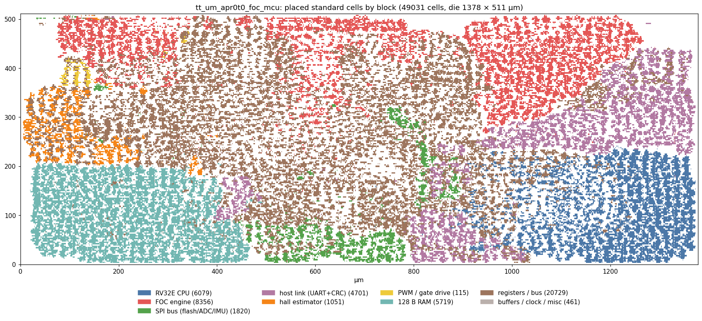

# Hardening (GDS) results

Flow: Tiny Tapeout `tt-support-tools` + LibreLane 3.0.14 (Docker), SKY130A (open_pdks 8afc834),
the same commands the Tiny Tapeout GitHub action runs. The hardening runs were done on a 56-core GCP VM.

## Tile size exploration

| Tiles | Die (µm) | Std-cell utilization | Global route overflow | Detailed route | Result |
|-------|----------|----------------------|-----------------------|----------------|--------|
| 8x2 | 1378 × 226 | 106 % (first RTL) | – | – | does not fit |
| 6x4 | 1030 × 511 | 58 % | 7965 | 119 166 violations after the first pass | does not route |
| 6x4, 64 B RAM | 1030 × 511 | 55 % | 3089 | 35 000 violations after 3 passes | does not route |
| **8x4** | **1378 × 511** | **43 %** | **0 (4 extra iterations)** | **0 violations** | **DRC clean, LVS clean** |

The register / bus fabric (≈ 8 300 cells, see the floorplan) and its wide read multiplexers dominate
the routing demand on the four Tiny Tapeout routing layers (met1–met4, met4 shared with the PDN).
That is why removing RAM alone does not make 6x4 routable.

## Floorplan

`docs/tools/floorplan_by_block.py` colours each placed cell by its RTL block. Hierarchy is recovered
from the net names, because LibreLane flattens and renumbers instances.

## Final sign-off (8x4, `CLOCK_PERIOD` 20 ns)

| Check | Result |
|-------|--------|
| Magic + KLayout DRC | pass |
| LVS (netgen) | pass |
| Antenna | pass (0 violations, heuristic diodes + repair) |
| Tiny Tapeout precheck (16 checks) | pass |
| Detailed-route DRC | 0 |
| Std-cell area / utilization | 408 899 µm² / 58.9 % of 704 736 µm² |
| Power (STA estimate at 50 MHz) | 17.8 mW |

| STA corner | Setup slack @ 20 ns | Hold slack | Max clock |
|------------|--------------------:|-----------:|----------:|
| nom tt 25 °C 1.80 V | +6.86 ns | +0.27 ns | ≈ 76 MHz |
| max tt 25 °C 1.80 V | +6.31 ns | +0.25 ns | ≈ 73 MHz |
| max ff −40 °C 1.95 V | +10.93 ns | +0.06 ns | > 100 MHz |
| nom ss 100 °C 1.60 V | −4.48 ns | +0.59 ns | ≈ 41 MHz |
| max ss 100 °C 1.60 V | −5.42 ns | +0.41 ns | ≈ 39 MHz |

The design runs at the nominal 50 MHz with 6 ns of margin at room temperature and nominal supply. At the
worst slow / hot / low-voltage corner it is good for about 39 MHz. Every register setting (PWM, baud
rate, dead time) is in clock cycles, so a lower clock only rescales them.

What made timing close:

- registered CPU data address, pipelined FOC integrator update, registered bus grant
- one registered reset copy per block; a single 4000-load reset net was the slow-corner critical path
- `RUN_POST_GRT_RESIZER_TIMING` (repair with global-route parasitics)
